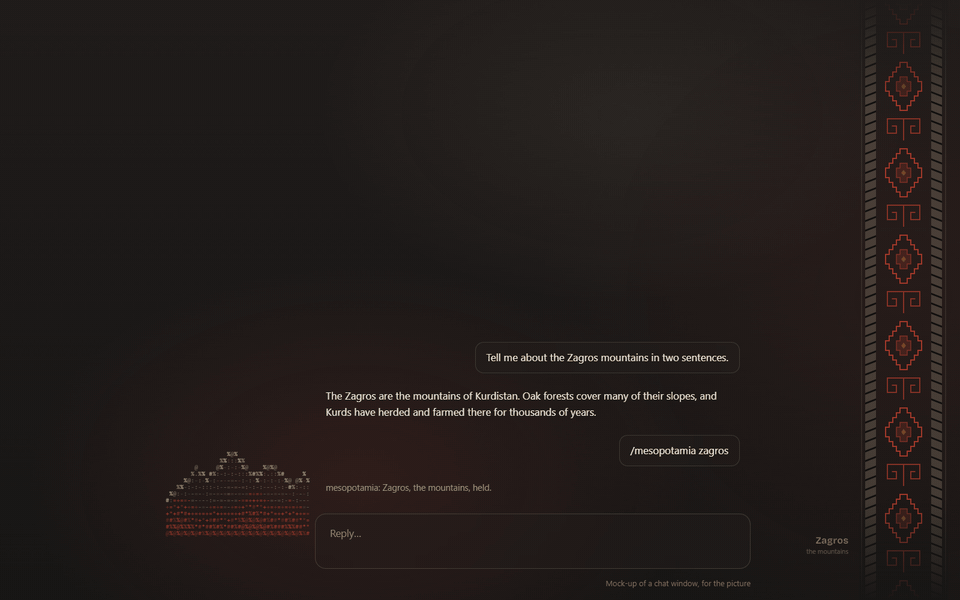

# Mesopotamia - Claude Desktop theme

A backdrop for the Claude desktop app, as a mod, inspired by Kurdistan: its rugs, its mountains and the things of Kurdish life. A flat-woven Kurdish rug climbs the right edge of the window, and small dithered ASCII motifs take turns beside the chat.


In motion (a 12 second loop):



Both pictures show the scene behind a mock-up of a chat window, with the Zagros motif held.

It is made for dark windows and keeps the app's own colors: only the ground behind the conversation changes.

- **The rug:** stepped red medallions with a ram's horn between each pair, and a border of thin black bars on each side, like the flank of the chukar partridge. It climbs slowly, like a marquee.
- **The motifs:** ten small pictures drawn in ASCII marks, one at a time, each one moving. They change every two minutes with a dithered dissolve, and a faint caption beside the rug names the one on show.
- **The glass:** the app's panels are frosted over two slow glows, so the chat reads as glass.

| Name | What it is | How it moves |
| --- | --- | --- |
| Roj | the sun | swells and shrinks |
| Zagros | the mountains of Kurdistan | glints |
| Kew | the chukar partridge | pecks |
| Hinar | the pomegranate | sways |
| Agir | the Newroz fire | flickers, sparks rise |
| Qoç | the ram | sways |
| Çay | tea | steam rises |
| Berû | oak leaf and acorn | sways |
| Tembûr | the long-necked lute | sways |
| Şilêr | the crown imperial | sways |

## Install

At the prompt of a Claude Code terminal session:

```
/plugin install mesopotamia --marketplace chiasabah/mesopotamia-theme
```

From a shell:

```
claude plugin install mesopotamia --marketplace chiasabah/mesopotamia-theme
```

In the Claude desktop app: click **+** next to the prompt box, then **Plugins**, add the marketplace `chiasabah/mesopotamia-theme`, then add the plugin **mesopotamia**.

The backdrop shows in the desktop and mobile apps. The terminal and the editors do not draw themes. It turns on by itself when a session starts.

## Use

```
/mesopotamia              turn it on and open a card with one button for each motif
/mesopotamia next         the next motif, held
/mesopotamia tea          one motif by name, held (Kurdish or English: çay, tea, hinar, pomegranate, ...)
/mesopotamia auto         all ten in turn again, one every two minutes
/mesopotamia list         the ten names
/mesopotamia off          back to the app's own look, for this session
```

The choice of motif is kept for the next sessions.

## Rules for a scene that moves

A backdrop scene is one SVG with its own style sheet. These rules decide whether the desktop app plays it or shows it as a still picture. The first one cost the most time, because a scene that breaks it still looks correct: it is only frozen.

1. **Hold no media query except the one for reduced motion.** The desktop app draws a scene still when its style sheet holds any other media query. A layout rule such as `@media (max-aspect-ratio: 3/2)` is enough to stop every animation in the scene. `@media (prefers-reduced-motion: reduce)` is the one that is allowed.
2. **Keep every style in the style sheet, none in a `style` attribute.** A surface can draw the scene under a policy that drops style attributes. Give each timing (`animation-delay`) and each pivot (`transform-origin`) a class with a rule of its own.
3. **Animate with CSS keyframes given by class.** This is what the scenes that ship with Claude Code do, and it plays.
4. **Give a changed scene a new name.** The app keeps one drawing for each scene name and does not draw a name again while it stands. Put a build number in the name and raise it with every change, or you can be looking at an old drawing.
5. **Do not rely on a font.** A font embedded with `@font-face` and a data URL is not loaded. For a specific typeface, draw the words as outlines traced from the font.
6. **Set the theme more than once.** A set made at `session.start` can be lost. Set it again a few seconds later, when a window joins the session (`session.attach`), and at the first prompt. A name that stands is not drawn again, so the extra sets cost nothing.
7. **Place things without media queries.** To keep art at the right edge in a narrow window, pin the root with `preserveAspectRatio="xMaxYMid slice"`.

## What was tried, and what did not work

The scene was frozen in the desktop app for a long time while it played in every browser test. In order:

| Tried | Result |
| --- | --- |
| CSS keyframes, plus 22 media queries on the window's shape to move the art inward in narrow windows | Frozen. The media queries were the cause, but nothing pointed at them |
| Checking the system: the operating system's animation setting, graphics acceleration | Both fine. Not the cause |
| Removing the reduced-motion rule | No change. That rule is allowed, and it is back |
| Rewriting all motion as SMIL (`animateTransform`, `animate`) | No change. Not needed |
| Much faster motion, and a new scene name for each build | No change alone. Both are kept: slow motion is easy to mistake for none, and a standing name is not redrawn |
| Replacing the mask over the moving rug with two gradient veils | Kept as a simplification. Not shown to matter |
| A font embedded as a data URL for the caption | Not loaded. The names are outlines now |
| Setting the theme only at `session.start` | The backdrop was sometimes missing until a command. It is now set again on a timer, when a window joins, and at the first prompt |
| **Removing every media query but reduced motion, and every `style` attribute** | **It moves** |

What gave the answer was a scene that did play in the same window, and the change notes of another theme whose author had met the same freeze. If a scene of yours is frozen, compare it with one that plays, and look at the media queries first.

## Files

- `hooks/register.tsx`: the backdrop, the `/mesopotamia` command and the card of buttons.
- `hooks/scene.ts`: the rug, the glows and the caption, drawn as one SVG.
- `hooks/motifs.ts`: the ten motifs, each a small function turned into dithered ASCII marks.
- `hooks/caption-outlines.ts`: the motif names as outlines. Generated: a new name needs a new outline.
- `types/index.d.ts`: the state the card draws from.

## Credits

- The finding about media queries comes from the change notes of [SynthWave '84 for Claude Desktop](https://github.com/stillgbx/synthwave-claude) by stillgbx.
- The motif names are drawn from the outlines of [Bricolage Grotesque](https://github.com/ateliertriay/bricolage) (SIL Open Font License 1.1, see `OFL.txt`).
- The scenes of the `theme-examples` plugin that ships with Claude Code were the model for how a scene is built.

## License

MIT, see `LICENSE`. The outlines in `hooks/caption-outlines.ts` are derived from Bricolage Grotesque and stay under the SIL Open Font License 1.1.
